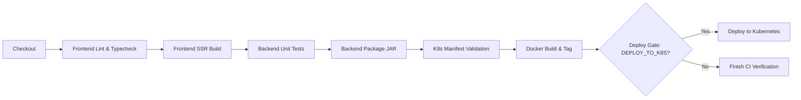

# Jenkins CI/CD Pipeline Setup Guide

This guide describes how to configure, run, and maintain the automated Continuous Integration and Continuous Deployment (CI/CD) pipeline for the **Student Attendance Management System** using Jenkins.

---

## 1. Prerequisites

Ensure your Jenkins controller (or worker agent) satisfies the following requirements:

### Software & Environment
- **Jenkins LTS**: Version 2.440 or newer.
- **Java Development Kit (JDK)**: Eclipse Temurin OpenJDK 21.
- **Node.js**: Node 22 LTS with `npm` (v10+).
- **Docker Engine**: Installed on agent with the Jenkins user added to the `docker` group (`sudo usermod -aG docker jenkins`).
- **kubectl**: CLI v1.28+ installed on the agent PATH.

### Required Jenkins Plugins
Install the following plugins via **Manage Jenkins > Plugins > Available Plugins**:
- **Pipeline** (Workflow Aggregator)
- **Git Plugin**
- **NodeJS Plugin**
- **Credentials Binding Plugin**
- **JUnit Plugin** (for publishing backend test results)
- **AnsiColor Plugin** (for colored console output)
- **Docker Pipeline Plugin**

---

## 2. Global Tool Configuration

Navigate to **Manage Jenkins > Tools**:

### JDK Configuration
1. Click **Add JDK**.
2. **Name**: `JDK21`.
3. Choose **Install automatically** from Adoptium/Eclipse Temurin (select Java 21) OR set `JAVA_HOME` pointing to local JDK 21 installation (e.g. `/usr/lib/jvm/temurin-21-jdk`).

### NodeJS Configuration
1. Click **Add NodeJS**.
2. **Name**: `Node22`.
3. Choose **Install automatically** from nodejs.org (select NodeJS 22.x LTS).

---

## 3. Jenkins Credentials Setup

Navigate to **Manage Jenkins > Credentials > System > Global credentials > Add Credentials**:

### 1. GitHub Container Registry (GHCR) Credentials
- **Kind**: `Username with password`
- **Scope**: `Global`
- **Username**: Your GitHub username (e.g. `trishulreddy3`)
- **Password**: GitHub Personal Access Token (PAT) with `read:packages`, `write:packages`, and `delete:packages` scopes.
- **ID**: `ghcr-registry-credentials` *(Must match the ID in `Jenkinsfile`)*
- **Description**: `GHCR Container Registry Authentication`

### 2. Kubernetes Cluster Kubeconfig Secret
- **Kind**: `Secret file`
- **Scope**: `Global`
- **File**: Upload your target cluster's `kubeconfig` file (ensuring the service account has RBAC rights in the `pulse-attendance` namespace).
- **ID**: `k8s-kubeconfig-secret` *(Must match the ID in `Jenkinsfile`)*
- **Description**: `Kubernetes cluster access kubeconfig`

> [!SECURITY NOTE]
> Never print or echo `$REGISTRY_PASS` or `$KUBECONFIG_FILE` in pipeline console logs. The pipeline uses Jenkins `withCredentials` masking to prevent accidental credential leakage.

---

## 4. Pipeline Job Creation

1. From the Jenkins dashboard, select **New Item**.
2. Enter item name: `pulse-attendance-pipeline`.
3. Select **Pipeline** (or **Multibranch Pipeline**) and click **OK**.
4. In the **General** section:
   - Check **Discard old builds** (Log Rotator: Max # of builds to keep: `20`).
   - Check **This project is parameterized** (parameters defined in `Jenkinsfile` will automatically register after the first run).
5. In the **Pipeline** section:
   - **Definition**: `Pipeline script from SCM`
   - **SCM**: `Git`
   - **Repository URL**: `https://github.com/trishulreddy3/attendance.git` (or your repository URL)
   - **Credentials**: Select your Git clone credential if private
   - **Branch Specifier**: `*/main`
   - **Script Path**: `Jenkinsfile`
6. Click **Save**.

---

## 5. Pipeline Stages & Execution Flow

The `Jenkinsfile` implements a robust 8-stage declarative workflow:

### Stage Details

1. **Checkout**: Clones the commit SHA and sets up environment variables.
2. **Frontend Verification**: Runs parallel stages for `npm ci`, `npm run lint`, and `npx tsc --noEmit` to validate code quality and TypeScript compilation.
3. **Frontend Build**: Compiles the Nitro SSR server and Vite bundles (`npm run build`).
4. **Backend Tests**: Executes Maven Surefire test suite (`./mvnw clean test`), verifying 7-period daily attendance, reports, and authentication services. Publishes JUnit XML test reports.
5. **Backend Package**: Compiles the runnable Spring Boot JAR (`./mvnw package -DskipTests`) and archives the JAR artifact.
6. **Validate K8s Manifests**: Validates Kubernetes manifests and Kustomize overlays using `kubectl kustomize k8s/`.
7. **Docker Build**: Builds multi-stage production Docker images for frontend and backend tagged with the immutable commit SHA (`IMAGE_TAG`) and `latest`.
8. **Controlled Deploy to Kubernetes**: Triggered only when the `DEPLOY_TO_K8S` parameter is set to `true`. Securely authenticates to GHCR, pushes images, applies Kustomize manifests to the `pulse-attendance` namespace, and checks rollout health.

---

## 6. Running Builds and Triggering Deployments

### CI-Only Build (Default)
Click **Build with Parameters** and leave `DEPLOY_TO_K8S` unchecked (`false`). The pipeline executes all code verification, automated tests, builds, and manifest validation without modifying the Kubernetes cluster.

### Production Deployment Build
1. Click **Build with Parameters**.
2. Check `DEPLOY_TO_K8S` = `true`.
3. Select `TARGET_ENVIRONMENT` = `production`.
4. Click **Build**.
5. Once test and container stages succeed, Jenkins authenticates using the stored credentials and performs a zero-downtime rolling update on the Kubernetes cluster.

---

## 7. Troubleshooting

| Issue | Cause | Resolution |
| :--- | :--- | :--- |
| `permission denied while trying to connect to Docker daemon` | Jenkins user not in `docker` group | Run `sudo usermod -aG docker jenkins` and restart Jenkins (`sudo systemctl restart jenkins`). |
| `npm ci fails with lockfile mismatch` | `package-lock.json` out of sync | Run `npm install` locally, commit the updated `package-lock.json`, and push. |
| `mvnw: Permission denied` | Shell execution bit missing | In Git, run `git update-index --chmod=+x backend/mvnw` and commit. |
| `Cannot find credentials 'ghcr-registry-credentials'` | Credential ID mismatch | Verify the exact credential ID in **Manage Jenkins > Credentials**. |
| `Rollout status timed out` | Pod failed readiness probe | Check pod events using `kubectl describe pod -l app=pulse-backend -n pulse-attendance` and pod logs. |
