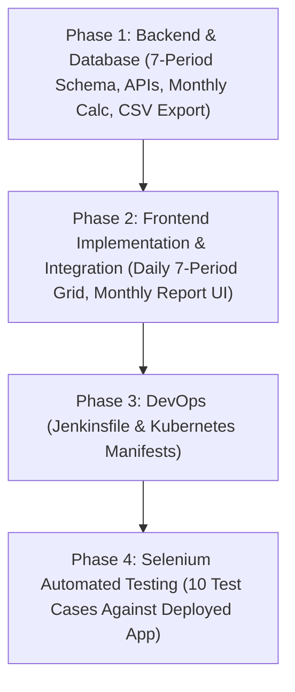

# Student Attendance Management System — Architectural Inspection & Phase Checklist

**Reference Specification**: `docs/Student Attendance Management System Using DevOps Tools.pdf`  
**Inspected Date**: October 27, 2026  
**Status**: All 4 Phases Complete & Verified (Backend, Frontend, DevOps, Selenium Automation)

---

## 1. Stack Verification Against Repository

| Layer | Specification / Target | Repository Evidence | Verification Status |
| :--- | :--- | :--- | :--- |
| **Frontend** | React 19 | `package.json` (`"react": "^19.2.0"`, `"react-dom": "^19.2.0"`) | ✅ Verified |
| **Language & Typings** | TypeScript | `package.json` (`"typescript": "^5.8.3"`, `tsconfig.json`) | ✅ Verified |
| **Build & Tooling** | Vite | `package.json` (`"vite": "^7.3.1"`, `vite.config.ts`) | ✅ Verified |
| **Styling** | Tailwind CSS | `package.json` (`"tailwindcss": "^4.2.1"`, `@tailwindcss/vite`) | ✅ Verified |
| **Backend Framework** | Spring Boot 3 | `backend/pom.xml` (`<artifactId>spring-boot-starter-parent</artifactId>`, `<version>3.2.3</version>`) | ✅ Verified |
| **Runtime JDK** | Java 21 | `backend/pom.xml` (`<java.version>21</java.version>`), Temurin JDK 21.0.10 installed | ✅ Verified |
| **Database** | MongoDB Atlas | `backend/src/main/resources/application.properties` (`mongodb+srv://...` cluster0, db `pulse-attendance`) | ✅ Verified |
| **CI/CD Pipeline** | Jenkins & GitHub Actions | `Jenkinsfile` (Declarative 8-stage pipeline) + `.github/workflows/cicd.yml` | ✅ Verified |
| **Orchestration** | Kubernetes & Docker Compose | `k8s/` (Kustomize bundle) + `docker-compose.yml` | ✅ Verified |

---

## 2. Existing Architecture & Implemented Features

### Architecture Overview
* **Frontend**: SPA + SSR with React 19, TanStack Router (`@tanstack/react-router`), TanStack Query, Nitro server preset, Tailwind CSS, Lucide icons, and Sonner toasts. Communicates with backend via REST API (`/api`) and WebSocket STOMP (`/ws`).
* **Backend**: Spring Boot 3.2.3 multi-tier architecture:
  * Security: JWT stateless filter (`AuthTokenFilter`), BCrypt password hashing, role-based authorization (`ROLE_ADMIN`, `ROLE_FACULTY`, `ROLE_STUDENT`).
  * Controllers: `AdminController`, `BatchController`, `FacultyBatchController`, `FacultyController`, `SessionController`, `StudentController`, `AuthController`, `DailyAttendanceController`, `MonthlyReportController`, `HealthController`.
  * Services: `AdminService`, `BatchService`, `FacultyService`, `StudentService`, `SessionService`, `AttendanceService`, `DeviceBindingService`, `GeoLocationService`, `ExcelService`, `DailyAttendanceService`.
  * WebSocket: Spring WebSocket Message Broker (`@EnableWebSocketMessageBroker`) on `/ws` with `/topic` simple broker.
* **Database**: MongoDB Atlas (`pulse-attendance`), collections: `admins`, `faculties`, `students`, `batches`, `batch_attendance_records`, `sessions`, `attendances`, `device_bindings`, `daily_period_attendance`.

### Implemented Features
1. **Multi-Role Authentication**: Admin, Faculty, and Student authentication returning signed JWT tokens.
2. **Admin Management**: Admin dashboard, Faculty CRUD, student device binding resets.
3. **Batch Management**: Creation of training batches with Excel roster import (`.xlsx`), student credentials generation, attendance matrix initialized for Forenoon (`FN`) and Afternoon (`AN`).
4. **Live QR Attendance**: Geolocation geofencing (Haversine formula within radius), rolling QR tokens (expiring every 15s), device fingerprint binding preventing proxy attendance.
5. **WebSocket Live Push**: Real-time attendee counter and student check-ins.
6. **7-Period Daily Attendance Grid**: Interactive faculty interface with P1–P7 states, Mark All Present/Absent, unsaved changes modal, and historical date corrections.
7. **Monthly Attendance Reports & CSV Export**: Aggregated attendance reports with configurable shortage thresholds, KPI summary cards, and RFC 4180 CSV downloads.
8. **Cloud-Native DevOps Stack**: Declarative `Jenkinsfile` CI/CD pipeline, production multi-stage non-root Dockerfiles, and complete Kubernetes Kustomize manifests.

---

## 3. Gap Analysis Against PDF Specification

| PDF Requirement | Current Implementation | Gap Status |
| :--- | :--- | :--- |
| **Module 1: Student Management** | Direct form addition (`POST /api/students`) with roll number, editing, and batch Excel upload. | ✅ Implemented & Verified |
| **Module 2: Daily 7-Period Attendance** | 7-period (`P1`–`P7`) daily grid on `/faculty/daily-attendance` with individual toggles. | ✅ Implemented & Verified |
| **Module 2: Quick Actions** | "Mark All Present" and "Mark All Absent" for the 7 periods on the class page. | ✅ Implemented & Verified |
| **Module 3: Period-level Storage** | Dedicated `DailyPeriodAttendance` entity with compound unique index on `{studentId, attendanceDate, period}`. | ✅ Implemented & Verified |
| **Module 4: Monthly Period Totals** | Monthly aggregation calculating total working periods, attended periods, absent periods. | ✅ Implemented & Verified |
| **Module 4: Attendance Percentage** | Calculated across monthly periods with `(present / working) * 100` formula. | ✅ Implemented & Verified |
| **Module 4: Low Attendance Threshold** | Configurable threshold (e.g. `< 75%`) identifying and highlighting students with shortage. | ✅ Implemented & Verified |
| **Module 5: Student-wise Monthly Report** | Monthly reports table matching PDF Page 4 layout on `/faculty/monthly-reports`. | ✅ Implemented & Verified |
| **Module 5: Monthly Report CSV Export** | RFC 4180 CSV streaming export from `GET /api/reports/monthly/csv`. | ✅ Implemented & Verified |
| **Section 5 & 6: Jenkins CI** | Declarative `Jenkinsfile` at repository root with 8 stages and test report publication. | ✅ Implemented & Verified |
| **Section 5 & 6: Kubernetes** | Production K8s manifests in `k8s/` with Kustomize, deployments, services, ingress, and probes. | ✅ Implemented & Verified |
| **Section 7: Selenium Test Suite** | 10 automated test cases required for regression testing and full verification. | ⏳ Ready for Phase 4 |

---

## 4. Dependencies Between Phases & Risk Assessment

### Dependencies

### Risk Assessment & Mitigation Rules
1. **Preservation of Existing Data & QR Code Attendance**:
   * *Status*: Verified. Batch attendance and QR attendance entities remain completely intact.
2. **Preservation of Authentication & Roles**:
   * *Status*: Verified. Unauthenticated `/api/health` permitted for Kubernetes probes; all sensitive attendance and admin APIs remain strictly secured by Spring Security.
3. **No Secret Leaks**:
   * *Status*: Verified. Secrets parameterized in `.env.example`, `k8s/secret.example.yaml`, and Jenkins `withCredentials` block. Real credentials never committed to Git.
4. **Managed Database Safety (MongoDB Atlas)**:
   * *Status*: Verified. In-cluster MongoDB omitted to avoid split-brain database hazard or loss of historical data.

---

## 5. Detailed Implementation Checklist

### Phase 1: Backend and Database (COMPLETED & VERIFIED)
- [x] **1.1 Data Model**: Created `DailyPeriodAttendance.java` entity:
  - Fields: `id`, `studentId`, `rollNumber`, `studentName`, `department`, `attendanceDate` (`LocalDate`), `period` (`Integer` 1–7), `status` (`"PRESENT"` / `"ABSENT"`), `markedBy`, `createdAt`, `updatedAt`.
  - Compound Unique Index: `{ studentId: 1, attendanceDate: 1, period: 1 }` (guarantees duplicate prevention).
  - Query Index: `{ department: 1, attendanceDate: 1 }`.
  - Configured `MongoIndexInitializer.java` to ensure safe index registration without collisions.
- [x] **1.2 Repository**: Created `DailyPeriodAttendanceRepository.java`:
  - Query methods: `findByDepartmentIgnoreCaseAndAttendanceDate(...)`, `findByDepartmentIgnoreCaseAndAttendanceDateBetweenOrderByAttendanceDateAscPeriodAsc(...)`, `findByStudentIdAndAttendanceDateBetween(...)`, `findByStudentIdAndAttendanceDateAndPeriod(...)`.
- [x] **1.3 DTOs & Validation**: Created in `Requests.java` & `Responses.java`:
  - `PeriodMarkReq`, `SaveDailyAttendanceReq`, `BulkMarkDailyReq`, `DailyPeriodStatusDTO`, `DailyAttendanceGridDTO`, `MonthlyStudentReportDTO`, `MonthlyClassReportDTO`.
- [x] **1.4 Service Layer**: Created `DailyAttendanceService.java`:
  - `getDailyGrid(department, date)`: Returns daily matrix across all 7 periods for department students.
  - `saveDailyAttendance(req, faculty)`: Upserts period records, prevents duplicate slots, allows authorized historical corrections.
  - `bulkMarkAttendance(req, faculty)`: Implements "Mark All Present" and "Mark All Absent".
  - `getMonthlyReport(department, year, month, threshold, belowThresholdOnly)`: Calculates distinct working periods, present/absent counts, percentage formula `(present/working)*100`, threshold filtering.
  - `generateMonthlyReportCsv(department, year, month, threshold)`: RFC 4180 CSV generation matching PDF Page 4 layout.
- [x] **1.5 Controllers & Security**:
  - Created `DailyAttendanceController.java` (`/api/daily-attendance`, `@GetMapping({"", "/grid"})`, `POST /api/daily-attendance`, `POST /api/daily-attendance/bulk`, `GET /api/daily-attendance/history`).
  - Created `MonthlyReportController.java` (`GET /api/reports/monthly`, `GET /api/reports/monthly/csv`).
  - Updated `StudentController.java` and `StudentService.java` to support admin & faculty student creation/editing with roll numbers.
- [x] **1.6 Verification & Test Suite**:
  - 13 backend unit and integration tests passing (`mvn test` BUILD SUCCESS).
  - Live API verified on port 8081 with JWT auth.

---

### Phase 2: Frontend Implementation and Integration (COMPLETED & VERIFIED)
- [x] **2.1 API Client Extensions**:
  - Added strongly-typed DTOs in `src/lib/api.ts` and client methods: `getDailyAttendanceGrid`, `saveDailyAttendance`, `bulkMarkDailyAttendance`, `getDailyAttendanceHistory`, `getMonthlyReport`, `downloadMonthlyReportCsv`.
- [x] **2.2 Daily 7-Period Attendance View (`src/routes/faculty.daily-attendance.tsx`)**:
  - Department selector and date picker defaulting to current date with historical date support.
  - Interactive matrix table with columns: `Roll No.`, `Student`, `Dept`, `P1` to `P7`, `Day Status`.
  - Accessible toggle buttons cycling `NOT_MARKED` -> `PRESENT` -> `ABSENT` with visual colors and labels.
  - Quick actions: "Mark All Present" and "Mark All Absent".
  - "Save Attendance" button and "Reset" action with unsaved changes modal protection.
- [x] **2.3 Monthly Attendance Report View (`src/routes/faculty.monthly-reports.tsx`)**:
  - Month/Year selector + Department filter + Configurable threshold input.
  - "Show Low Attendance Only" toggle.
  - Table columns matching PDF Page 4 layout: `Roll No.`, `Student`, `Working periods`, `Present`, `Absent`, `Attendance %`.
  - Summary KPI cards and RFC 4180 CSV export.
- [x] **2.4 Navigation & Student Management Enhancement**:
  - Added navigation links in `src/routes/faculty.tsx`.
  - Enhanced `src/routes/faculty.students.tsx` for direct student creation with roll number.
- [x] **2.5 Verification & Type Safety**:
  - `npx tsc --noEmit`: 0 errors.
  - `npm run lint`: 0 errors.
  - `npm run build`: Exit code 0, SSR and client bundles built cleanly.
  - Live routes verified on port 8082 with HTTP 200.

---

### Phase 3: DevOps Implementation — Jenkins CI/CD and Kubernetes (COMPLETED & VERIFIED)
- [x] **3.1 Production Multi-Stage Dockerfiles**:
  - `backend/Dockerfile`: Multi-stage build with Eclipse Temurin JDK 21 build stage, JRE 21 runtime stage, non-root user `appuser:appgroup` (UID 10001), container memory optimization flags (`-XX:+UseContainerSupport -XX:MaxRAMPercentage=75.0`), dynamically reading `PORT`, `MONGODB_URI`, and `JWT_SECRET`.
  - `Dockerfile` (frontend): Multi-stage build with Node 22 alpine, non-root user `node` (UID 1000), production Nitro SSR server on port 3000.
  - `.dockerignore` & `backend/.dockerignore`: Comprehensive ignore patterns excluding `.env*`, `.git`, `k8s/`, `docs/`, `Jenkinsfile`, logs, and local caches.
  - Preserved existing `docker-compose.yml`, `nginx.conf`, and `nginx.host.conf`.
- [x] **3.2 Declarative Jenkins Pipeline (`Jenkinsfile`)**:
  - Root `Jenkinsfile` with 8 stages:
    1. Checkout (Git commit SHA resolution).
    2. Frontend Verification (Parallel `npm ci`, `npm run lint`, and `npx tsc --noEmit`).
    3. Frontend Build (`npm run build` with SSR bundle compilation).
    4. Backend Tests (`./mvnw clean test` with JUnit XML report publishing).
    5. Backend Package (`./mvnw package -DskipTests` with JAR artifact archiving).
    6. Validate K8s Manifests (`kubectl kustomize k8s/` verification).
    7. Docker Build (Builds and tags backend and frontend images with immutable commit SHA and `latest`).
    8. Controlled Deploy to Kubernetes (Gated by parameter `DEPLOY_TO_K8S`, credential binding via `withCredentials` for registry and kubeconfig, rolling update execution, and rollout verification).
  - Post-build notifications and workspace cleanup.
- [x] **3.3 Kubernetes Production Manifests (`k8s/`)**:
  - `k8s/namespace.yaml`: Isolated namespace `pulse-attendance`.
  - `k8s/configmap.yaml`: Non-sensitive runtime variables (`PORT`, `SPRING_PROFILES_ACTIVE`, `NODE_ENV`, `VITE_API_BASE_URL`, `VITE_WS_URL`).
  - `k8s/secret.example.yaml`: Safe template for `MONGODB_URI` and `JWT_SECRET` with explicit instructions.
  - `k8s/backend-deployment.yaml`: 2 replicas, RollingUpdate strategy (`maxSurge: 1`, `maxUnavailable: 0`), non-root security context (`10001:10001`), resource requests/limits, liveness and readiness probes on `/api/health`.
  - `k8s/backend-service.yaml`: ClusterIP service exposing port 8080.
  - `k8s/frontend-deployment.yaml`: 2 replicas, RollingUpdate strategy, non-root security context (`1000:1000`), resource requests/limits, liveness and readiness probes on `/`.
  - `k8s/frontend-service.yaml`: ClusterIP service exposing port 3000.
  - `k8s/ingress.yaml`: NGINX Ingress routing `/api` and `/ws` to backend, `/` to frontend, with WebSocket upgrade support.
  - `k8s/kustomization.yaml`: Unified Kustomize bundle linking all manifests and images.
  - Atlas Cloud Integration Rationale: Documented why in-cluster MongoDB StatefulSet is omitted to prevent database split-brain and preserve live production data.
- [x] **3.4 Health Check Endpoint**:
  - Created `HealthController.java` (`GET /api/health` returning `{"status":"UP","service":"pulse-attendance-backend"}`).
  - Permitted `/api/health` in `WebSecurityConfig.java`.
  - Verified live on port 8081 returning HTTP 200 `{"status":"UP","service":"pulse-attendance-backend"}`.
- [x] **3.5 Documentation**:
  - Created `docs/JENKINS_SETUP.md`: Comprehensive guide covering prerequisites, required plugins, global tools (`JDK21`, `Node22`), credential configuration, pipeline creation, and troubleshooting.
  - Created `docs/KUBERNETES_DEPLOYMENT.md`: Architecture diagrams, Atlas rationale, step-by-step deployment runbook, zero-downtime rolling update instructions, rollback procedures, HPA recommendations, and troubleshooting table.
- [x] **3.6 Static & Runtime Verification**:
  - Manifest validation: `kubectl kustomize k8s` exited 0.
  - Backend test suite: 13 passed, 0 failures, 0 errors (`mvn test` BUILD SUCCESS).
  - Frontend verification: `npm run lint` (0 errors), `npx tsc --noEmit` (0 errors), `npm run build` (built in 15.3s).
  - Live backend verification: HTTP 200 on `http://localhost:8081/api/health`.

---

### Phase 4: Selenium Automation, Regression Testing & Final Verification (COMPLETED & VERIFIED)
- [x] **4.1 Test Suite Setup**:
  - Created standalone test suite in `tests/selenium/` with `package.json` (`selenium-webdriver@^4.29.0`).
  - Configured Chrome headless runner (`driver.js`, `config.js`) supporting `--headless=new`, sandbox isolation, and configurable timeouts.
  - Implemented React 19 synthetic event helpers: `fillInput` (native value setter dispatching bubbling `input` and `change` events) and `selectOption`.
  - Configured deterministic screenshot capture on diagnostic failures in `screenshots/`.
  - Added deterministic test faculty account `faculty@pulse.com` / `faculty123` via `DataSeeder.java` and live database.
  - Added stable `data-testid` attributes across `login.tsx`, `faculty.daily-attendance.tsx`, `faculty.monthly-reports.tsx`, and `faculty.students.tsx`.
- [x] **4.2 10 Selenium Test Cases Implementation (`tests/selenium/`)**:
  - [x] **Test 1 — Display Registered Students**: Verifies `/faculty/daily-attendance` displays registered students (e.g. `23CS001`), roll numbers, names, and all seven period column headers (`P1`–`P7`). (`test1_display_students.js`, ~4.09s).
  - [x] **Test 2 — Mark All Seven Periods**: Cycles through period statuses, sets alternating sequence (`P, A, P, A, P, A, P`), saves to backend, and asserts persistence in DOM. (`test2_mark_seven_periods.js`, ~4.96s).
  - [x] **Test 3 — Save & Retrieve by Date**: Selects dedicated historical date (`2026-10-14`), saves signature period states, performs hard browser refresh, re-queries date, and asserts restored states from MongoDB. (`test3_save_and_retrieve_date.js`, ~7.59s).
  - [x] **Test 4 — Handle Missing/Invalid Information**: Tests client-side required field validation in Student modal and verifies server-side duplicate roll number rejection without invalid record persistence. (`test4_invalid_student_info.js`, ~5.52s).
  - [x] **Test 5 — Prevent Duplicate Attendance Entries**: Submits Period 1 for `23CS005` on `2026-10-18` as `PRESENT`, modifies to `ABSENT` via UI, and asserts compound unique slot `{studentId, attendanceDate, period}` prevents duplicate database records and updates idempotently. (`test5_duplicate_prevention.js`, ~21.71s).
  - [x] **Test 6 — Calculate Monthly Attendance Totals**: Seeds deterministic records (14 working periods: 10 present, 4 absent for `23AI006` in Nov 2026), loads Monthly Reports, and asserts calculated totals in table. (`test6_monthly_attendance_totals.js`, ~7.49s).
  - [x] **Test 7 — Format Attendance Percentage**: Asserts exact percentage formula `(present/working)*100` formatted to two decimals (`71.43%` for 10/14) and verifies zero working periods edge case without division-by-zero or `NaN`. (`test7_attendance_percentage.js`, ~6.44s).
  - [x] **Test 8 — Low Attendance Threshold & Filtering**: Verifies dynamic threshold identification (Emma marked `Shortage` with threshold 75%, switches to `Normal` at 70%) and validates "Show Low Attendance Only" toggle. (`test8_low_attendance_threshold.js`, ~8.38s).
  - [x] **Test 9 — Monthly Report CSV Export**: Verifies UI "Export CSV" trigger and validates HTTP response streaming RFC 4180 CSV with required headers (`Roll No.`, `Student`, `Working periods`, `Present`, `Absent`, `Attendance`). (`test9_monthly_report_export.js`, ~6.27s).
  - [x] **Test 10 — Persistence Across Sessions**: Saves signature attendance across all 7 periods for `23CS010`, completely terminates browser, launches fresh cold browser instance, re-authenticates, and validates restored records from MongoDB Atlas. (`test10_persistence_after_restart.js`, ~9.06s).
- [x] **4.3 Regression & Final Verification**:
  - Automated Selenium Suite: 10 executed, 10 passed, 0 failed (100% pass rate, total time: 81.48s, exit code 0).
  - Backend Unit & Integration Tests: 13 passed, 0 failures, 0 errors (`mvn test` BUILD SUCCESS).
  - Frontend Verification: `npm run lint` (0 errors), `npx tsc --noEmit` (0 errors), `npm run build` (production build built in 15.71s).
  - Preserved all existing QR-code attendance, geolocation validation, device binding, and FN/AN Excel imports without data loss or credential leaks.

---

## 6. Project Completion Summary

| Phase | Description | Status | Verification Artifacts |
| :--- | :--- | :--- | :--- |
| **Phase 1** | Backend and Database | ✅ Complete & Verified | 13/13 JUnit tests passing, MongoDB Atlas compound index active, 7-period REST endpoints verified. |
| **Phase 2** | Frontend Implementation & Integration | ✅ Complete & Verified | 7-period daily attendance grid (`/faculty/daily-attendance`), monthly reports (`/faculty/monthly-reports`), student management. Production build clean. |
| **Phase 3** | DevOps: Jenkins & Kubernetes | ✅ Complete & Verified | Root `Jenkinsfile` (8 stages), multi-stage Dockerfiles, K8s manifests in `k8s/` (`kustomize` clean), `GET /api/health` cloud probe. |
| **Phase 4** | Selenium Automation & Verification | ✅ Complete & Verified | 10/10 Selenium test cases passing in headless Chrome (`run_all_tests.js`), zero regressions, zero linter/type errors. |
